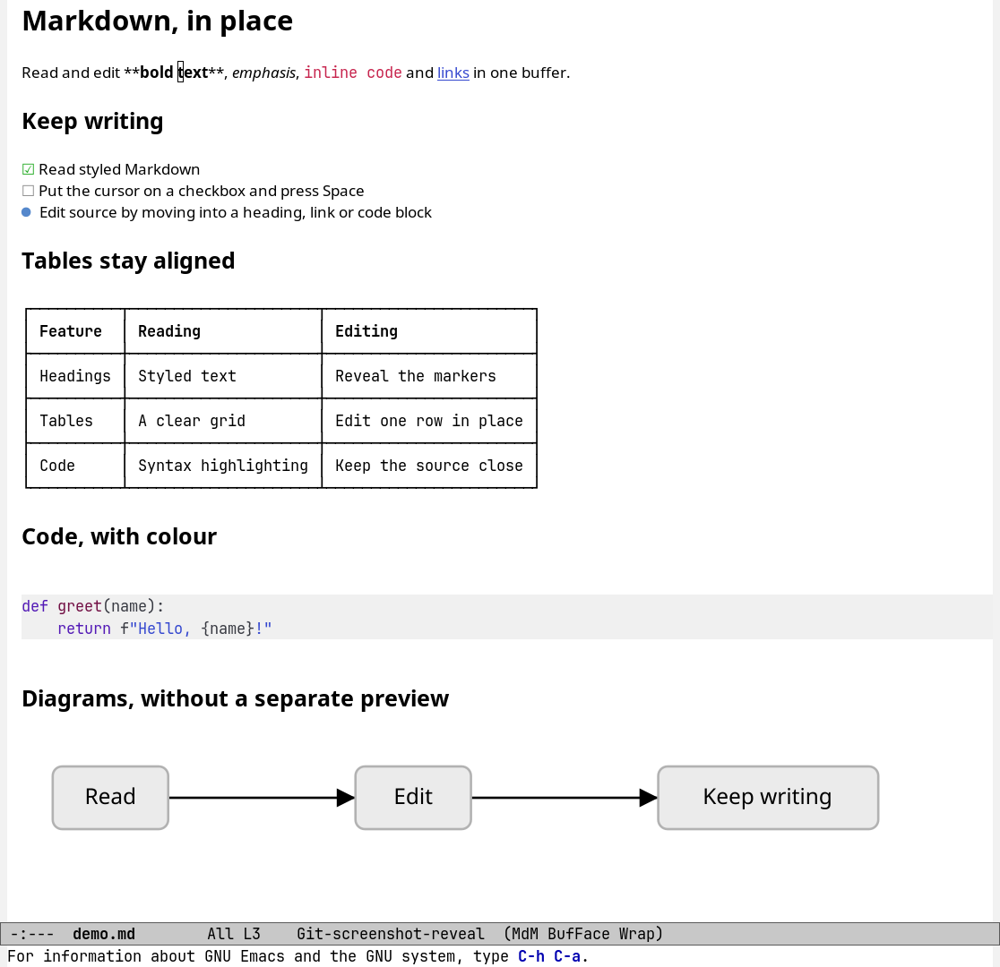
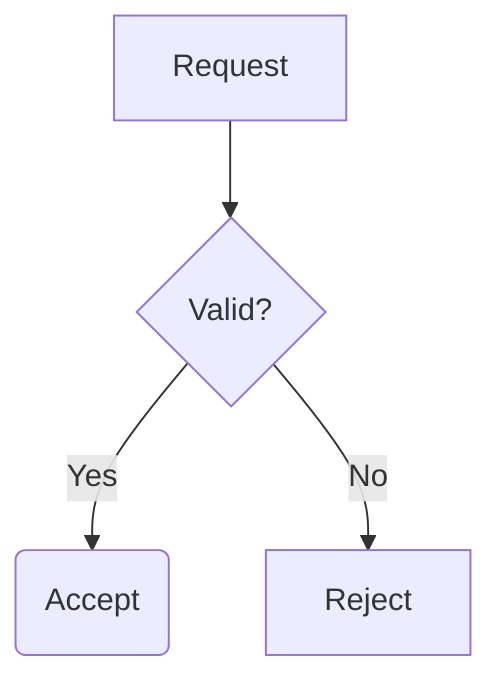
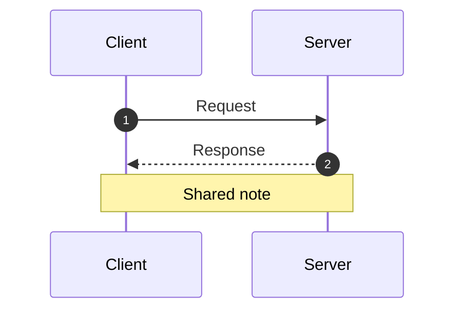
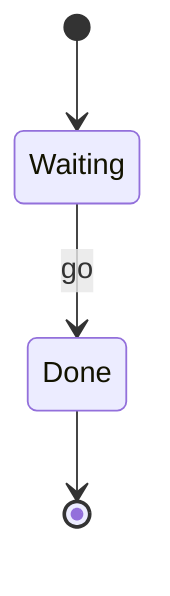
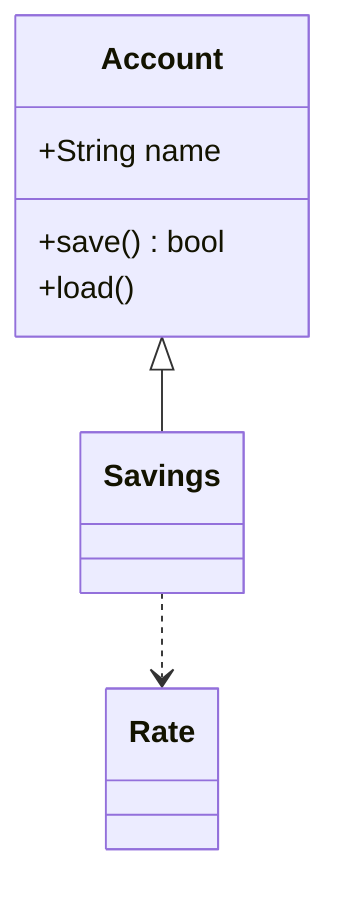
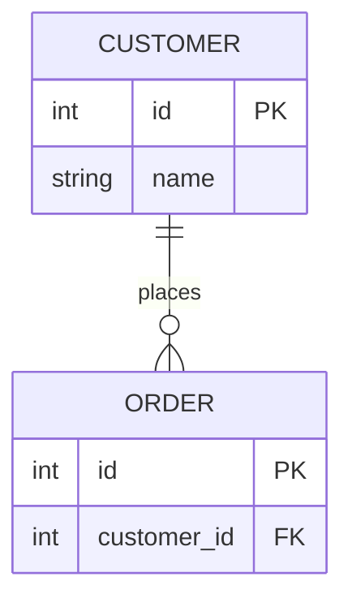
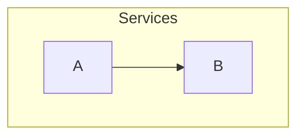
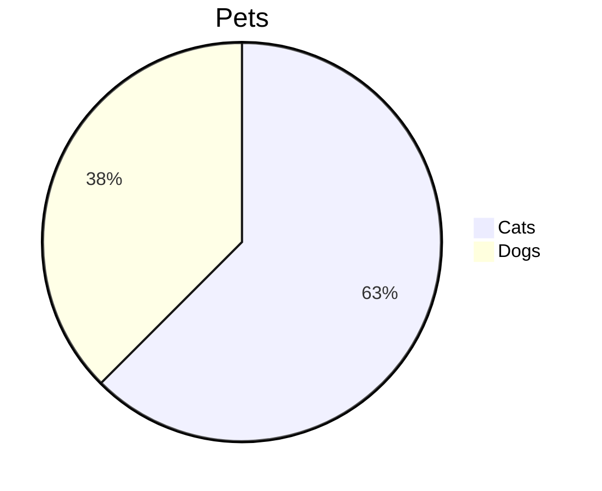

# Manual test file

Open this file in `markdown-modern-mode` and work through it from top to
bottom. Each section says what to try. Things that went wrong before are
marked "Regression".

## Headings

# Level 1
## Level 2
### Level 3
#### Level 4
##### Level 5
###### Level 6

Try: put point on each heading. The `#` markers appear at the heading's size.
`C-c C-n` and `C-c C-p` move between headings, `C-c C-u` goes to the parent.
`TAB` on a heading folds it.

## Inline formatting

This has **bold**, *italic*, ***bold italic***, `inline code` and
~~strikethrough~~. Underscores work too: __bold__ and _italic_.

Combined: **bold with `code` inside**, *italic with a [link](https://example.com)*,
and ~~struck **bold**~~.

Escaped characters stay literal: \*not italic\*, \`not code\`, \# not a heading.

Try: move point into each element. Only that element shows its delimiters, and
its style stays. Move away and it is drawn again.

## Paragraphs and line breaks

This paragraph is wrapped over several source lines. They should show as one
flowing paragraph that fills the window width. The file itself keeps the
line breaks. Type a character in here and the source lines show, with a `↵`
at each newline that will show as a space.

This line ends with two spaces for a hard break.  
So this line starts on its own line.

This line ends with a backslash for a hard break.\
So does this one.

A blank line keeps paragraphs apart.

Try: type in the first paragraph, then move out and pause. The lines join
again.

## Links

- Inline: [Emacs](https://www.gnu.org/software/emacs/)
- With a title: [GitHub](https://github.com "GitHub home")
- Reference: [the changelog][changelog]
- Autolink: <https://github.com/rjprins/markdown-modern>
- Local file: [the main source file](../lisp/markdown-modern.el)
- Local file at a line: [markdown-modern.el line 30](../lisp/markdown-modern.el#L30)
- Local line range: [lines 30 to 40](../lisp/markdown-modern.el#L30-L40)
- Heading in another file: [README editing model](../README.md#editing-model)
- Missing file: [does not exist](./no-such-file.md)

[changelog]: ../CHANGELOG.md

Try: click a link label, or press `C-c C-o` anywhere in a link. Local files open
in Emacs at the right line. `M-,` comes back here. The missing file reports an
error. Moving into a link with the keyboard shows its markup.

## Images




Try: both show inline, no wider than `markdown-modern-image-max-width`.

## Lists

Regression: the list right after this paragraph has no blank line before it,
and a rule follows it with no blank line. Move up and down through it. Each
item must keep exactly one bullet.
- Stay close to the underlying libs. Don't reinvent any wheels.
- Always provide a "way out", as in a documented customization path.
- Don't own the application.
---

Nested bullets cycle their glyph per level:

- Level one
  - Level two
    - Level three
      - Level four
- Back to level one, with **bold**, `code` and a [link](https://example.com)
- A long item that wraps. It goes on and on so that it is wider than the window,
  and the wrapped part lines up with the text of the first line, not with the
  bullet. Lorem ipsum dolor sit amet, consectetur adipiscing elit, sed do eiusmod.

Ordered lists:

1. First
2. Second
   1. Nested first
   2. Nested second
3. Third

1) Parenthesis style
2) Second item

Other markers:

* Star bullet
+ Plus bullet

Task list:

- [ ] Unchecked task
- [x] Checked task
- [ ] Task with **bold** text
  - [ ] Nested task
  - [x] Nested done task
- A plain item between tasks

Try:

- Point on a bullet shows `- `, and the text does not move.
- `M-RET` adds an item. `C-c <up>` and `C-c <down>` move an item.
  `C-c <left>` and `C-c <right>` change its level.
- `SPC` on a checkbox toggles it. `Backspace` on it removes the checkbox.
- Bullets and checkboxes start their text at the same column, also after
  `C-x C-+`.

## Blockquotes

> A simple quote.

> A quote over several lines. The lines join into one paragraph, and each
> continuation line keeps the bar.

> Outer quote
>> Nested quote

> A quote with a list:
> - first item
> - second item
>
> And **bold** text inside.

Try: point on a quote line shows the `>` marker.

## Code blocks

```emacs-lisp
(defun greet (name)
  "Say hello to NAME."
  (message "Hello, %s!" name))
```

```python
def greet(name: str) -> str:
    return f"Hello, {name}!"
```

```
A block without a language.
```

~~~javascript
// A tilde fence
const greet = (name) => `Hello, ${name}!`;
~~~

    An indented code block,
    four spaces deep.

- A list item with a code block inside:

  ```sh
  echo "inside a list"
  ```

Try: move into a block, it shows its fences. `C-c '` opens the code in its own
buffer with the language's mode. `C-c '` again saves, `C-c C-k` aborts.
Regression: after `C-c '` on the block in the list item, the list must still
have one bullet.

## Tables

| Left | Center | Right |
|:-----|:------:|------:|
| a | b | c |
| **bold** | `code` | [link](https://example.com) |
| longer text here | x | 1,234 |

| Name | Description |
|------|-------------|
| wide | This cell has a lot of text so the table is wider than the window. It should wrap inside the cell instead of wrapping the buffer. |
| short | ok |

Try: put point in a row. Only that row becomes editable, and its borders stay
in line with the box while you type. `TAB` and `S-TAB` move between cells, and
`TAB` in the last cell adds a row. `C-c C-v t` toggles horizontal scrolling.

## Horizontal rules

---

***

___

## Math

Inline math: $E = mc^2$ and $\alpha + \beta \leq \gamma$.

Display math:

$$
\int_{-\infty}^{\infty} e^{-x^2} dx = \sqrt{\pi}
$$

Try: point inside the math shows its source.

## Mermaid diagrams

Flowchart:



Sequence diagram:



State diagram:



Class diagram:



ER diagram:



A tilde fence:

~~~mermaid
flowchart LR
A[Start] --> B[Work] --> C[Done]
~~~

Unsupported, so it shows its source:



An unknown diagram type, also shown as source:



Try: click a diagram to open the viewer. Zoom with `+` and `-`, pan with the
arrow keys or by dragging, `f` fits, `0` is actual size, `q` comes back.
`C-c C-v d` in a diagram's source opens it too. The unsupported diagram
reports its error once in the echo area, not on every move.

## Footnotes

A statement with a footnote[^1], and another one[^note].

[^1]: The first footnote.
[^note]: A named footnote.

## HTML

<details>
<summary>Click to expand</summary>

Hidden content.

</details>

Press <kbd>Ctrl</kbd> + <kbd>C</kbd>.

## Export

Try: `C-c C-e h` exports this file to HTML, and `C-c C-c p` previews it in a
browser. Mermaid blocks show as code there.

---

*End of the manual test file.*
